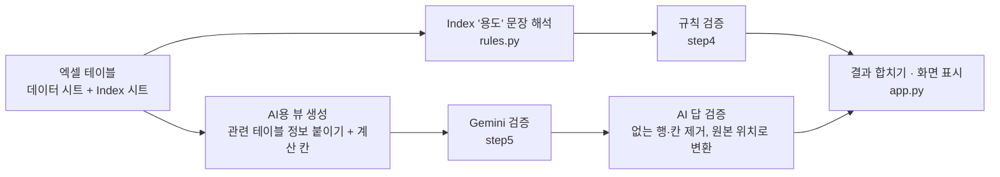

# 게임 데이터 검증 AI

게임 기획 데이터 테이블(엑셀)의 오류를 **규칙 기반 검증 + 생성형 AI(Gemini)** 로 찾아 주는 도구입니다.

- **웹 데모**: https://game-data-validator.streamlit.app/
- **시연 영상**: (링크 추가 예정)

> 샘플 데이터는 모두 직접 만든 **가상 데이터**입니다. 실제 회사 데이터는 사용하지 않았습니다.

---

## 만든 이유

기획자가 테이블을 수정하면 보통 아래 과정을 거쳐 라이브에 반영됩니다.

> 테이블 수정 → CI 툴(Jenkins 등)로 GD(게임 데이터 파일) 생성·개발 서버 적용 → QA 검증 → 라이브 서버 반영

이때 자료형에 맞지 않는 값이나 존재하지 않는 ID를 참조하는 데이터가 있으면, GD를 만든 뒤 개발 서버에서 실행할 때 오류가 납니다.
그러면 문제 데이터를 찾고, 고치고, GD를 다시 만드는 데 **한 번에 10분 이상**이 걸립니다. 현업에서는 이런 일로 개발 흐름이 끊기는 경우가 자주 있었습니다.

**규칙 검증**은 이 문제를 줄이기 위해 필요합니다. 테이블을 올리기 전에 도구로 먼저 검사하면 개발·테스트 과정의 지연을 줄일 수 있습니다.

하지만 규칙 검증만으로는 **밸런스 오류**(레벨 대비 지나치게 높은 체력, 등급에 맞지 않는 가격 등)를 잡을 수 없습니다.
이런 오류가 그대로 라이브에 반영되면 긴급 점검처럼 큰 사고로 이어질 수 있습니다.

그래서 기계적으로 확인할 수 있는 것은 **규칙**으로, 맥락 판단이 필요한 것은 **AI**로 나누어 검증하는 도구를 만들었습니다.

---

## 개발 방식

AI(Claude)를 멘토로 삼아 **단계별 미션 방식**으로 학습하며 구현했습니다.
AI가 단계별 목표와 힌트를 제시하면 제가 코드를 작성하고, 막힌 부분은 설명을 듣고 직접 고치는 방식으로 진행했습니다.
제공받은 코드도 동작을 이해한 뒤 사용했습니다.

| 구분 | 내용 |
|---|---|
| **직접 구현** | 규칙 검사 함수 8개 (`step4` 미션 2\~9) · 프롬프트 작성과 판단 기준 설계 · AI 호출과 답 검증 (`step5` 미션 1\~3) · 계산 칸과 요약 통계 (`ai_calc` 미션 A\~C) · `to_source`의 아이템 이름 경로 · 검증 코드를 함수로 분리 · 웹 화면 기능 (결과 유지, 합치기, 필터, 다운로드, 참조 누락 확인, 샘플 zip) |
| **제공받아 이해 후 사용** | 테이블 읽기(`common.py`) · Index 문장 해석(`rules.py`) · AI용 표 생성(`ai_views.py`) · 채점(`evaluate.py`) · 샘플 데이터와 정답표 · 웹 화면 기본 틀 |
| **직접 결정·설계** | 프로젝트 주제와 문제 정의 · Index 명세 작성 방식 · 판단 기준 수정과 1~7차 실험 · 새 테이블 대응 등 기능 개선 방향 · 배포 시 API 키 공개 방식 |

---

## 주요 기능

| 기능 | 설명 |
|---|---|
| **규칙 검증** | 각 테이블의 `Index` 시트(컬럼명 / 자료형 / 용도)를 읽어 검증 규칙을 **자동 생성** |
| **AI 검증** | 같은 등급·레벨대와 비교해 튀는 값, 이름·설명 불일치, 오타 등 **맥락이 필요한 오류**를 Gemini로 탐지 |
| **결과 합치기** | 같은 행을 규칙·AI가 함께 찾으면 한 줄로 합쳐서 표시 (`규칙 / AI`) |
| **필터 · 다운로드** | 테이블·출처별 필터, 화면에 보이는 결과를 엑셀로 다운로드 |
| **폴더 업로드** | 내 테이블 폴더를 올려서 검사 (Index 형식을 지킨 테이블이면 새 테이블도 규칙 검증 가능) |
| **안내** | 샘플 테이블 zip 다운로드, 테이블 작성 규칙 안내, AI 실패 테이블 안내 |

---

## 동작 방식



### Index 시트 → 규칙 자동 생성 예시

| Index '용도'에 쓴 문장 | 만들어지는 규칙 |
|---|---|
| `허용값: 일반 / 고급 / 희귀 / 영웅 / 전설` | 목록에 없는 값 검사 |
| `FK → Item.item_id` | 다른 테이블에 없는 ID 검사 |
| `형식: ITEM_NAME_{item_id}` | 같은 행 ID와 맞지 않는 키 검사 |
| `min_count 이상` | 다른 칸보다 작은 값 검사 |
| `무기·방어구 1, 소모품 99, 재료 999` | type에 따라 정해진 값 검사 (조건부 규칙) |

기획자가 평소처럼 Index를 작성하면 **코드를 고치지 않아도** 새 테이블에 규칙이 적용됩니다.

---

## 설계에서 고민한 점

### 1. 계산은 코드가, 판단은 AI가
AI에게 `100 × level^1.4` 같은 공식을 직접 계산하게 했더니 **계산을 틀려서 정상 데이터를 오류로 판단**했습니다 (실제 23,240 → AI 계산 15,350).
그래서 공식값·비율(`hp_공식대비%`, `가격_중앙값대비%`)과 요약 통계를 **코드가 미리 계산해서** 표에 붙이고, AI는 그 숫자를 보고 판단만 하도록 변경했습니다.

→ 정상 데이터 오탐 3~6건 → 0건 (5·6차 실험)

### 2. 규칙으로 잡을 수 있는 것은 규칙으로
"소모품인데 max_stack이 1" 같은 오류는 AI가 실행할 때마다 잡았다 놓쳤다 했습니다.
Index 문장(`무기·방어구 1, 소모품 99`)을 해석하는 **조건부 규칙**을 추가해 AI 없이 매번 확실하게 잡도록 옮겼습니다.

→ 규칙·인덱스 분류 오류 36/36 탐지

### 3. AI의 답을 그대로 믿지 않기
AI는 없는 행 번호나 없는 컬럼을 답하기도 합니다. 이를 해결하기 위해
- 행 번호·컬럼명이 실제로 있는지 확인한 뒤 채택
- 이름·설명 오류는 실제 텍스트가 있는 `StringTable` 위치로 되돌려 표시
- 호출 실패(타임아웃·형식 오류)와 "오류 없음"을 구분해서, 실패한 테이블은 화면에 안내

### 4. 기준은 정상 데이터 분포를 보고 정하기
처음에는 "±25% 벗어나면 오류"로 정했지만, 정상 데이터의 가격 비율이 이미 18~327%로 넓게 퍼져 있어 오탐이 났습니다.
정상 데이터 분포를 먼저 확인한 뒤 기준(15% 미만 / 330% 초과)을 다시 정했습니다.

---

## 실험 결과

오류 48건(규칙 23 · 인덱스 13 · AI 12)을 심은 데이터와 정상 데이터로 측정했습니다.
채점 기준: (테이블, 엑셀 행)이 정답표와 일치하면 탐지로 인정 (`evaluate.py`)

| 차수 | 변경 내용 | 전체 탐지 (규칙+AI) | AI 분류 | 정상 데이터 오탐 |
|---|---|---|---|---|
| 0차 | 규칙 검증기 | 34/48 (71%) | — | 0 |
| 1차 | AI 추가 | 92% | 8/12 | 4 |
| 2차 | 판단 기준 보강 | 98% | 11/12 | 3 |
| 3차 | Index 명세 수정 | 96% | 10/12 | 3 |
| 4차 | 계산 칸 추가 (기준 ±25% 유지) | — | 8/12 | 6 |
| 5차 | 가격 기준·컬럼 선택 규칙 | 96% | 10/12 | **0** |
| 6차 | 아이템 이름 → StringTable 위치 변환 | 92% | 9/12 | **0** |
| 7차 | "한 항목에 한 문제" 규칙 | 94% | 10/12 | 4 (환각) |
| 이후 | 조건부 규칙 추가 | 규칙만 **36/48 (75%)**, 규칙·인덱스 분류 **36/36** | — | 0 |

**정리**
- 규칙 검증은 규칙·인덱스 분류 오류를 **모두** 찾고, 정상 데이터 오탐 0건
- AI를 더하면 전체 탐지율 **92\~98%**. 같은 설정에서도 실행마다 1\~2건씩 달라짐
- 계산 칸 도입 후 AI 계산 실수로 인한 오탐이 사라짐

---

## 알려진 한계

| 한계 | 내용 |
|---|---|
| AI 비결정성 | `temperature=0`이어도 실행마다 1~2건씩 결과가 달라짐 |
| 환각 | 명세에 없는 규칙을 만들어 정상 값을 오류로 판단하는 경우가 있음 (7차: 4건) |
| 컬럼 선택 오류 | 오류는 찾았지만 다른 칸(예: 이름 대신 설명)을 지목하는 경우 |
| 연쇄 오류 | 한 행의 오류 때문에 다른 행까지 이상해 보이는 경우를 함께 보고 |
| 비교 근거 부족 | 공식·통계가 없는 값(예: 보상 골드)은 AI도 판단하기 어려움 |
| AI 뷰 구조 | AI 검증은 현재 샘플 테이블 구조(Item·Monster·DropGroup·Quest·Reward)만 지원 |

---

## 향후 개선

- **AI 뷰 자동 생성**: 규칙처럼 Index의 참조 정보(`FK →`, `형식:`)를 읽어 AI용 표를 자동으로 만들기 → 새 테이블도 AI 검증
- **여러 번 실행해 공통 결과만 채택**: 환각처럼 한 번만 나타나는 오탐 줄이기
- **조건부 최솟값 규칙**: `장비는 등급별 최소 레벨 이상 (일반 1, 고급 5 …)` 해석
- **Index 작성 방식 자동 변환**: 지금은 정해진 표현(`허용값:`, `FK →` 등)으로 Index를 작성해야 합니다.
  회사·팀마다 쓰는 Index 형식 그대로 올리면, AI가 문장을 해석해 검증 규칙으로 바꿔 주는 기능

---

## 프로젝트 구조

```
game-data-validator/
├── app.py                   # Streamlit 웹 화면
├── common.py                # 테이블·Index 시트 읽기
├── rules.py                 # Index '용도' 문장 → 검증 규칙
├── step4_rule_validator.py  # 규칙 검증 (validate_rules)
├── step5_ai_validator.py    # AI 검증 (validate_ai): 프롬프트, 호출, 답 검증
├── ai_views.py              # AI용 표 만들기, 원본 위치 변환 (to_source)
├── ai_calc.py               # 계산 칸(공식 대비 %, 중앙값 대비 %)과 요약 통계
├── evaluate.py              # 정답표 기준 채점
├── step0~3_*.py             # 환경 점검, 테이블 읽기, Index 해석, Gemini 연결 연습
├── data/
│   ├── data_error/          # 오류 48건을 심은 샘플 테이블 6개
│   ├── data_clean/          # 정상 샘플 테이블 (오탐 측정용)
│   └── answer_key.xlsx      # 정답표
├── requirements.txt
└── .env.example             # API 키 설정 예시
```

---

## 실행 방법

```bash
# 1. 설치 (Python 3.13)
python -m venv .venv
.venv\Scripts\activate          # macOS/Linux: source .venv/bin/activate
pip install -r requirements.txt

# 2. (AI 검증을 쓸 경우) .env.example을 .env로 복사하고 Gemini API 키 입력
#    웹 화면에서 키를 직접 입력해도 됩니다.

# 3. 웹 화면 실행
streamlit run app.py

# 터미널에서 실행·채점
python step4_rule_validator.py            # 규칙 검증 → output/rule_result.xlsx
python step5_ai_validator.py              # AI 검증 → output/combined_result.xlsx
python evaluate.py output/combined_result.xlsx
```

---

## 배운 점

- **AI를 쓰는 방식의 확장**: 그동안 AI는 궁금한 것을 물어보거나 무언가를 만들어 달라고 할 때만 사용했습니다.
  이번 프로젝트에서는 AI를 프로그램 안에 넣어, 테이블 데이터를 읽고 오류를 판단하는 **검증 도구의 일부**로 사용했습니다.
  AI를 대화 상대가 아니라 업무 흐름 속 기능으로 쓸 수 있다는 것을 배웠습니다.
- **실험 → 측정 → 개선 사이클**: 정답표와 채점 스크립트를 먼저 만들어 두니, 프롬프트를 바꿀 때마다 효과를 숫자로 확인할 수 있었습니다.
  감으로는 좋아 보였던 변경이 실제로는 오탐을 늘린 경우(4차)도 숫자로 발견했습니다.
- **스크립트에서 웹 서비스로**: 터미널에서만 돌던 코드를 함수로 분리하고, Streamlit 화면과 배포까지 연결하는 구조를 배웠습니다.
- **기획자 관점의 강점**: 기획자가 이미 작성하는 Index 시트를 그대로 검증 규칙으로 쓰는 아이디어처럼, 현업의 불편함을 아는 것이 설계에 직접 도움이 됐습니다. 예전에는 개발자에게 요청해야 했던 도구를, 이제는 문제를 겪는 사람이 AI와 함께 직접 만들 수 있다는 것을 배웠습니다.
- **AI와 함께 학습하는 방법**: 완성된 코드를 받는 대신 단계별 목표와 힌트를 받아 직접 작성했습니다.
  막힐 때마다 오류의 원인을 설명받고 스스로 고치면서, "왜 그렇게 동작하는지" 이해할 수 있었습니다.

